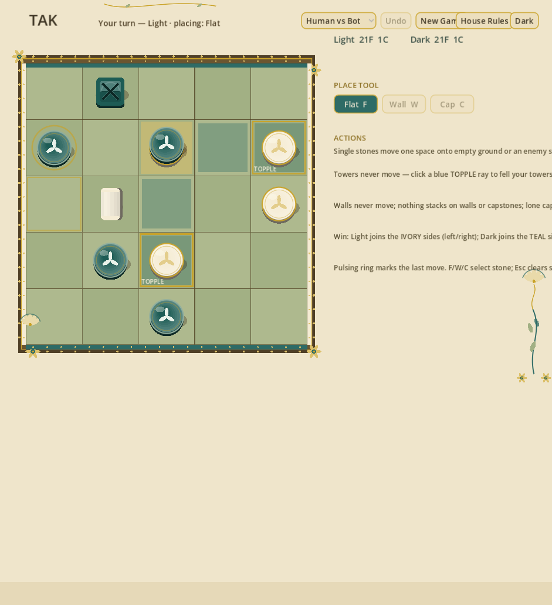

# Tak

A two-player digital implementation of [Tak](https://en.wikipedia.org/wiki/Tak_(fictional_game)), the abstract strategy board game from Patrick Rothfuss's *The Kingkiller Chronicle*, built with **Godot 4.7** (pure GDScript, no external assets) and finished in an Art Nouveau skin: parchment and sage, bronze-and-gold beading, ivory and malachite glass stones, procedurally synthesized wooden SFX.



## Rules implemented (5x5)

- Each player: 21 flat stones + 1 capstone
- Opening moves: each player places one of the *opponent's* flats
- **Single stones** move one space orthogonally onto empty ground or an enemy-topped cell
- **Towers (2+) never move** — they may only be *toppled*: the whole tower lays down in a straight line, bottom-to-top, one stone per cell, in any direction with room; falling stones land on empty ground or enemy tops, walls in a tower re-stand and need empty cells
- **Tower colors strictly alternate** — you can never stack onto your own top piece
- Walls never move; nothing stacks on a wall or a capstone; only a lone capstone may enter an *enemy* wall-topped cell, flattening it (the flattened stone stays the original owner's; a capstone may never enter a wall of its own color)
- Win by road: an orthogonally connected chain of your flats/capstones (top pieces only) joining **any two opposite edges of the board** — either pair counts for either player; if the game ends by board fill / no legal moves, winner is by count of top flats
- No captures; no diagonals

## Running

Install Godot 4.7 (or later 4.x), then:

```bash
godot --path .
```

## Controls

- Click an empty square to place; **F / W / C** (or the Place Tool buttons) select flat / wall / capstone
- Click one of your single stones → green neighbors appear → click one to move it
- Every move is animated: stones glide in an arc, toppled towers fan out stone by stone, placements pop in; the cells of the last move pulse with an orange ring until the next move
- Click one of your towers → blue TOPPLE rays appear → click any ray cell to fell the tower (orange-capped cell marks the far end of each ray)
- **Undo** (or Ctrl+Z), **New Game**, **House Rules**, **Light/Dark**, and a **Human vs Bot / Hotseat / Bot vs Bot** switch live in the top bar — Bot vs Bot lets you spectate two MCTS players
- Entering a wall with a lone capstone is labeled `FLATTEN`

## The AI opponent

`scripts/mcts_bot.gd` is a UCT Monte Carlo Tree Search player:

- Time-budgeted (2 s default), executed in small chunks per frame so the UI never freezes
- Fast random-rollout policy backed by a cheap move sampler and bitmask road detection in the engine (`scripts/tak_state.gd`)
- Roughly 500–1,200 playouts per move on a laptop — a solid casual opponent

## Tests

A headless rules/AI suite lives in `Probe.gd`:

```bash
godot --headless --path . --import
godot --headless --path . -s res://Probe.gd   # 30 tests
```

## Project layout

| File | Purpose |
|---|---|
| `scripts/tak_state.gd` | Rules engine: move generation/validation, roads, endgame |
| `scripts/mcts_bot.gd` | UCT MCTS player |
| `scripts/main.gd` | UI scene logic (board rendering, input, turn flow) |
| `scenes/Main.tscn` | Main scene |
| `Probe.gd` | Headless test suite |

## Note

Tak is a game devised by Patrick Rothfuss and developed for publication by James Ernest / Cheapass Games. This is an unofficial, from-the-rules fan implementation; no game components or trademarks are included.

## License

MIT — see [LICENSE](LICENSE).
